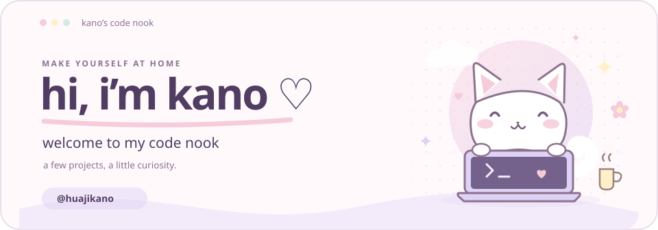
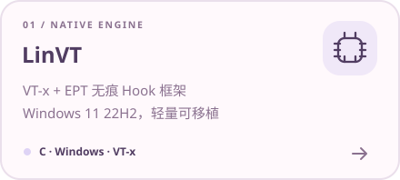
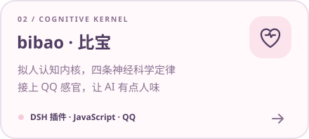
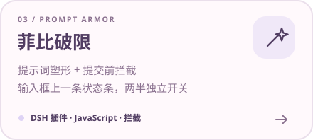
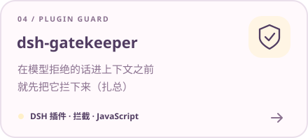
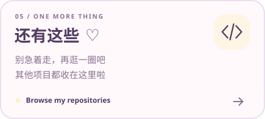

  <picture>
    <source media="(prefers-color-scheme: dark)" srcset="./assets/hero-dark.svg">
    
  </picture>

  <strong>欢迎来我的代码窝 ♡</strong> 
  项目都放在这里啦，随便逛逛～

  
  &nbsp;
  
  &nbsp;
  

 

### 🐾 我的拿手好戏

- 🎮 **Windows 底层 & 逆向**：C / C++、VT-x + EPT 无痕 Hook、内存分析与调试。
- 🤖 **AI Agent & MCP**：工具集成、任务编排与上下文管理，让 AI 真能动手做事。
- 🧪 **DSH 插件 & 提示词工程**：提示词注入、提交前拦截、输入框状态条，一个插件两半各自开关。
- 🧩 **桌面 & 全栈**：TypeScript、Electron、React、SQLite，从 Web 服务到双击即用的工具。
- 🛠 **实用小工具**：C# / WinForms 单文件绿色程序，不装不依赖，打开就能用。

### 🧶 用到的技术

  
  
  
  
  
  
  
  

 

### 🎀 公开项目精选

<a href="https://github.com/huajikano/LinVT">
  <picture>
    <source media="(prefers-color-scheme: dark)" srcset="./assets/linvt-dark.svg">
    
  </picture>
</a>
<a href="https://github.com/huajikano/bibao">
  <picture>
    <source media="(prefers-color-scheme: dark)" srcset="./assets/bibao-dark.svg">
    
  </picture>
</a>

<a href="https://github.com/huajikano/dsh-feibi-breaker">
  <picture>
    <source media="(prefers-color-scheme: dark)" srcset="./assets/feibi-dark.svg">
    
  </picture>
</a>
<a href="https://github.com/huajikano/dsh-gatekeeper">
  <picture>
    <source media="(prefers-color-scheme: dark)" srcset="./assets/dsh-gatekeeper-dark.svg">
    
  </picture>
</a>

<a href="https://github.com/huajikano?tab=repositories">
  <picture>
    <source media="(prefers-color-scheme: dark)" srcset="./assets/explore-dark.svg">
    
  </picture>
</a>

  点开卡片看看吧，没准有你感兴趣的 ♡

 

  <picture>
    <source media="(prefers-color-scheme: dark)" srcset="./assets/footer-dark.svg">
    
  </picture>

